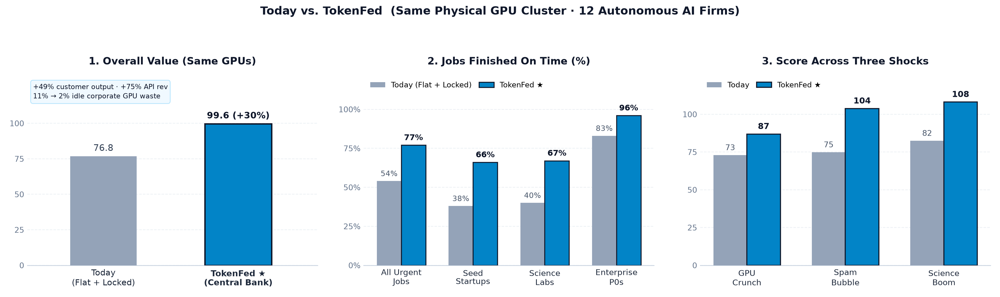

# tokenfed

Companion simulation for [*The Token Fed*](https://www.strangeloopcanon.com/p/the-token-fed) on Strange Loop Canon.

Links: [Essay](https://www.strangeloopcanon.com/p/the-token-fed) · [Interactive Monitor](https://strangeloopcanon.github.io/tokenfed/) · [Full Tables](results/summary.md)

## Overview

`tokenfed` models how a frontier AI lab allocates a fixed GPU cluster (`~59.7k` tokens per 5-round episode) between internal R&D and external API demand when tokens act as both scarce compute and working capital.

Twelve autonomous LLM firms compete for capacity across four cohorts (3 enterprises with reserved blocks, 3 cash-tight startups, 3 grant-capped science labs, and 3 cash-rich slop swarms) while solving real Python tasks with staging and held-out test suites. Each seed runs across three shocks (GPU crunch, spam swarm, science boom) under four regimes:

1. `flat_today` — Flat `1.0x` pricing, locked enterprise blocks, fixed `28%` internal training.
2. `pure_market` — Spot surge auction, `0.5x` batch queue, voluntary block subleasing, fixed training.
3. `rule_fed` — Static Taylor-style rule flexing internal training, startup credit, and a science reserve.
4. `llm_fed` — Live central-bank governor adjusting supply, pricing, credit, and reserve levers from queue telemetry.

## Results (48 Runs)



| Regime | Overall Score (Output + R&D) | Urgent Done | Science Done | Startups Done | Swarms Done | Idle Waste | Lab API Yield |
| :--- | :---: | :---: | :---: | :---: | :---: | :---: | :---: |
| 1. Today (`flat_today`) | 76.8 (57.5 + 19.3) | 54% | 40% | 38% | 37% | 11% | 1.00x |
| 2. Pure Market (`pure_market`) | 88.2 (68.8 + 19.3) | 64% | 29% | 69% | 88% | 2% | 1.46x |
| 3. Static Rule (`rule_fed`) | 94.8 (82.2 + 12.5) | 75% | 50% | 74% | 82% | 2% | 1.21x |
| 4. Token Fed (`llm_fed`) | 99.6 (85.8 + 13.8) | 77% | 67% | 66% | 79% | 2% | 1.28x |

## Quickstart

Saved runs, confidence intervals, self-tests, and figures run offline without LLM calls:

```bash
# Run accounting and task verification checks
python3 run_benchmark.py --self-test-only

# Recompute summary tables and dashboard data from saved episodes
python3 analyze.py results/benchmark_runs.json
python3 export_dashboard_data.py results/benchmark_runs.json

# Regenerate charts into figures/
uv run --with matplotlib --with numpy python3 plot_report_charts.py
```

## Layout

- `token_fed/` — Simulation engine (`models.py`, `scenarios.py`, `tasks.py`, `governor.py`, `sim.py`, `agy_client.py`)
- `results/` — Saved 48-episode data (`benchmark_runs.json`, `summary.json`, `summary.md`, `dashboard_data.json`)
- `figures/` — Charts generated by `plot_report_charts.py`
- `docs/index.html` — Standalone interactive dashboard

## License

MIT — see [LICENSE](LICENSE).
