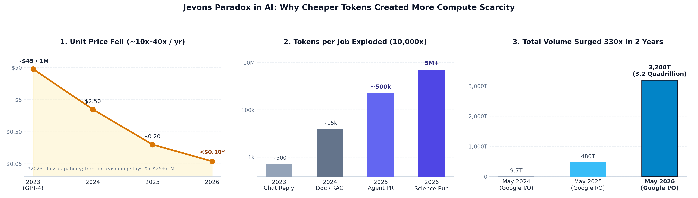
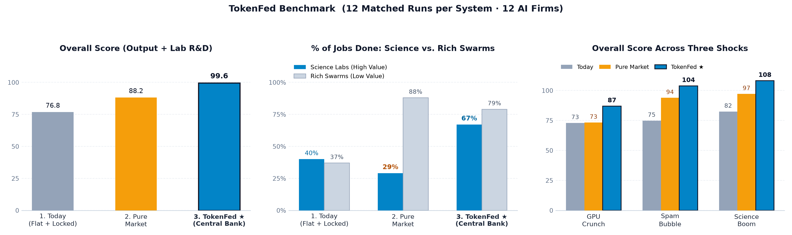
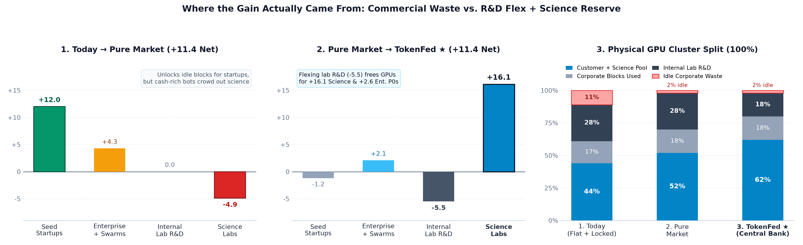
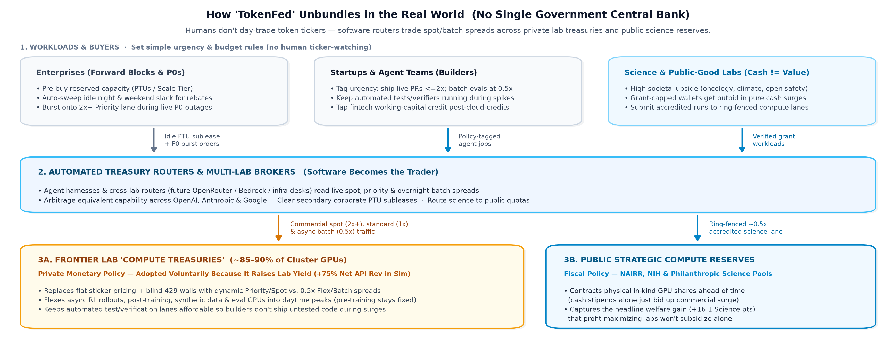

# TokenFed

Multi-sector simulation testing how an AI frontier lab—and the surrounding agent economy—should govern scarce GPU capacity when **tokens act simultaneously as a physical commodity and working capital**.

Across **`48` five-round episodes (`2,304` real Python coding & unit-test tasks · `4,977` live LLM turns)**, `1` frontier lab (`~59.7k`-token cluster split between internal R&D and public APIs) serves `12` autonomous AI firms across four cohorts:
- **`3` Enterprises** — Pre-purchased reserved throughput blocks (`PTUs` / `Scale Tier`) plus urgent P0 production incidents.
- **`3` Seed Startups** — High-value feature & bugfix backlogs, tight initial cash runway.
- **`3` Science & Oncology Labs** — High societal upside, strict grant-capped budgets (`Cash != Value`).
- **`3` Speculative / Slop Swarms** — Low marginal real value, deep instant-payback cash wallets.



---

## Governance Regimes & Macro Shocks

Each matched seed runs the identical physical cluster and task arrivals across **three shocks** (**`GPU Crunch`** `-37%` outage, **`Spam Bubble`**, and **`Science Boom`**) under **four governance systems**:

1. **`1. Today` (`flat_today`)** — Flat `1.0x` API sticker price, locked corporate reservations, fixed `28%` internal lab training split (`44` blind `429` lockouts/run; `11%` of cluster stranded idle inside corporate blocks).
2. **`2. Pure Market` (`pure_market`)** — Uniform-price Spot surge auction + `0.55x` preemptible Batch + `85%`-rebate corporate block subleasing; fixed `28%` internal training.
3. **`3. Static Rule Fed` (`rule_fed`)** — Hardcoded Taylor-style formula flexing internal training during crunches, taxing commercial surge, capping unit-test/verifier pricing at `<=1.0x`, extending `5%` working-capital credit to startups, and reserving a `22%` science lane (`0.55x`).
4. **`4. TokenFed ★` (`llm_fed`)** — Live LLM governor adjusting those same central-bank levers each round from observable queue and price telemetry (blind to scenario labels and true sector value weights).



| System | Overall Score *(Output + R&D)* | Urgent Jobs Done | Science Done | Startups Done | Rich Swarms Done | Idle Cluster Waste | Net Lab API Yield |
| :--- | :---: | :---: | :---: | :---: | :---: | :---: | :---: |
| **1. Today** *(Flat + locked blocks)* | `76.8` *(`57.5` + `19.3`)* | `54%` | `40%` | `38%` | `37%` | **`11%`** | `1.00x` |
| **2. Pure Market** *(Auction + sublease + Batch)* | `88.2` *(`68.8` + `19.3`)* | `64%` | `29%` | `69%` | **`88%`** | `2%` | **`1.46x`** |
| **3. Static Rule Fed** *(Hardcoded Taylor formula)* | `94.8` *(`82.2` + `12.5`)* | `75%` | `50%` | **`74%`** | `82%` | `2%` | `1.21x` |
| **4. TokenFed ★** *(Live central-bank governor)* | **`99.6`** *(`85.8` + `13.8`)* | **`77%`** | **`67%`** | `66%` | `79%` | `2%` | `1.28x` |

---

## Anatomy of the Gain & Real-World Unbundling



- **Opposing mechanisms behind two equal `+11.4` jumps:** Moving from `Today → Pure Market` (`76.8 → 88.2`) reclaims dead corporate blocks (`11% → 2%`) and rescues **Seed Startups (`+12.0`)**, while crowding out **Science (`-4.9`)**. Moving from `Pure Market → TokenFed ★` (`88.2 → 99.6`, `12/12` paired wins) pauses non-urgent internal R&D (`28% → 18%` of cluster, `-5.5` pts; in practice async RL rollouts, post-training & evals rather than monolithic pre-training) to fund **Science (`+16.1`)** and **Enterprise P0s (`+2.6`)** while raising net lab API cash revenue `+75%` vs. `Today`.
- **Why live governance beats a hardcoded formula in bubbles:** `Static Rule Fed` matched `TokenFed` in `GPU Crunch` (`86.3` vs. `86.9`), but got fooled in `Spam Bubble` (`95.8` vs. `103.8`)—draining internal lab R&D to feed high-bidding spam swarms instead of taxing commercial surge.
- **Monetary vs. fiscal split:** Because `Pure Market` yields labs a higher per-token cash margin (`1.46x` vs. `1.28x`) by letting slop swarms outbid grant-capped scientists, profit-maximizing labs will adopt the **monetary layer** voluntarily (dynamic spreads, subleasing, peak RL flexing), while public/philanthropic buyers (`NAIRR`, `NIH`) must supply the **fiscal layer** by contracting physical GPU blocks.



---

## Repository Layout

- [`token_fed/`](token_fed/) — Multi-sector simulation engine:
  - [`models.py`](token_fed/models.py) & [`scenarios.py`](token_fed/scenarios.py) — Sector wallets, PTU contracts, and 3 shock trajectories.
  - [`tasks.py`](token_fed/tasks.py) — Deterministic Python coding & held-out verification benchmark tasks (`16` problems · `320` assertions).
  - [`governor.py`](token_fed/governor.py) — `Today`, `Pure Market`, `Static Rule Fed`, and live `TokenFed` governors.
  - [`sim.py`](token_fed/sim.py) — Round-by-round clearing, PTU sublease rebates, `5%` working-capital credit window, and fiscal accounting.
  - [`agy_client.py`](token_fed/agy_client.py) — Bounded-concurrency async CLI LLM harness (configurable via `AGY_BIN`).
- [`results/`](results/) — Canonical 48-episode data ([`summary.md`](results/summary.md), [`summary.json`](results/summary.json), [`dashboard_data.json`](results/dashboard_data.json), [`benchmark_runs.json`](results/benchmark_runs.json)).
- [`figures/`](figures/) — Publication charts generated by [`plot_report_charts.py`](plot_report_charts.py), including both the full 3-system comparisons ([`token_fed_chart.png`](figures/token_fed_chart.png), [`token_fed_decomposition.png`](figures/token_fed_decomposition.png)) and the simplified 2-system *Today vs. TokenFed* essay charts ([`token_fed_2bar.png`](figures/token_fed_2bar.png), [`token_fed_decomposition_2bar.png`](figures/token_fed_decomposition_2bar.png)).
- [`docs/index.html`](docs/index.html) — Standalone interactive Compute Monetary Monitor (open directly in any browser or serve via GitHub Pages).

## Quickstart & Verification

All saved benchmark data, bootstrap confidence intervals, self-tests, and figures verify offline in seconds with **zero LLM calls**:

```bash
# 1. Verify accounting invariants & deterministic task test suites (zero LLM calls)
python3 run_benchmark.py --self-test-only

# 2. Recompute summary tables, confidence intervals & dashboard JSON from saved runs
python3 analyze.py results/benchmark_runs.json
python3 export_dashboard_data.py results/benchmark_runs.json

# 3. Regenerate all 6 figures into figures/
uv run --with matplotlib --with numpy python3 plot_report_charts.py
```

## License

MIT — see [`LICENSE`](LICENSE).
